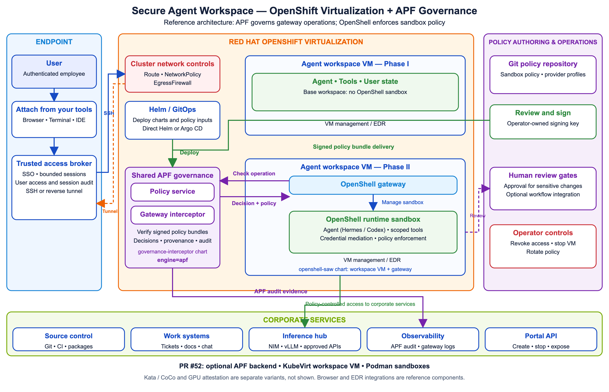

# Secure Agent Workspace

Secure Agent Workspace (SAW) gives each user an isolated AI agent workspace on
OpenShift. Every workspace runs NVIDIA OpenShell with an OpenClaw or NemoClaw
agent. Keycloak handles sign-in, only the owner can reach a workspace, and
provider keys stay outside the agent.

A workspace runs on one of three backends:

| Backend | Runs as | Use it when |
|---|---|---|
| **VM** (default) | One OpenShift Virtualization VM per user | You want the strongest isolation and the most tested path |
| **Container** | Pods in per-user namespaces, using the OpenShell Kubernetes driver | You don't have virtualization or want faster starts |
| **Kata** | Container workspaces in OpenShift sandboxed containers | You want container workspaces with VM-backed pod isolation |

This repository implements NVIDIA's
[Secure Agent Workspace reference design](https://docs.nvidia.com/enterprise-reference-architectures/secure-agent-workspace-reference-design/latest/openshift-virtualization-reference-implementation.html)
as a Red Hat Validated Pattern.

**Video walkthrough: from cluster installation to a working workspace**

https://github.com/user-attachments/assets/6858c0b1-239a-4a6a-b0e4-5872796dcc32

## Contents

- [Secure Agent Workspace](#secure-agent-workspace)
  - [Contents](#contents)
  - [How it works](#how-it-works)
  - [Requirements](#requirements)
  - [Installation](#installation)
    - [1. Fork and clone](#1-fork-and-clone)
    - [2. Log in to the cluster](#2-log-in-to-the-cluster)
    - [3. Prepare the cluster](#3-prepare-the-cluster)
    - [4. Add your keys](#4-add-your-keys)
    - [5. Deploy](#5-deploy)
  - [Add a user](#add-a-user)
    - [VM workspace](#vm-workspace)
    - [Container workspace](#container-workspace)
    - [Kata workspace](#kata-workspace)
    - [Remove a user or start over](#remove-a-user-or-start-over)
  - [Use your workspace](#use-your-workspace)
  - [Inference providers](#inference-providers)
    - [Supported inference providers](#supported-inference-providers)
    - [Custom inference provider](#custom-inference-provider)
  - [Governance with APF (optional)](#governance-with-apf-optional)
  - [Quickstart without GitOps](#quickstart-without-gitops)
  - [Uninstall](#uninstall)
  - [Testing](#testing)
  - [Security model](#security-model)
  - [Keycloak production and demo users](#keycloak-production-and-demo-users)
  - [Web UI sign-in (redirect URIs)](#web-ui-sign-in-redirect-uris)
  - [Repository structure](#repository-structure)
  - [References](#references)
  - [Tags](#tags)

## How it works



Argo CD deploys the platform from your fork: operators, Vault, External
Secrets, Keycloak, the governance service and the self-service portal. Each
entry in `overrides/saw-users.yaml` becomes a workspace. Users can also create
their own in Red Hat Developer Hub.

| Component | Technology | Purpose |
|---|---|---|
| Isolation | OpenShift Virtualization, or pods (optionally Kata) | One boundary per user |
| Identity | Red Hat Build of Keycloak | OIDC sign-in for the CLI and web UIs |
| Agent runtime | NVIDIA OpenShell + OpenClaw / NemoClaw | Sandboxes, gateway, inference routing |
| Secrets | Vault + External Secrets | Provider keys stay outside the sandbox |
| Governance | OpenShell governance interceptor, or APF | Fail-closed approval of gateway operations |
| GitOps | Argo CD (Validated Patterns) | Everything, including users, comes from Git |

| Namespace | Contents |
|---|---|
| `saw-<name>` | The user's workspace: the gateway VM, or the container sandbox and gateway |
| `saw-ctl-<id>`, `saw-ui-<id>` | Container workspaces only: controller and browser relay |
| `saw-history-<id>` | Container workspaces with audit receipts only: signed audit history, kept after deletion |
| `openshell-agents` | Golden VM image, image builds, governance service |
| `saw-keycloak` | Keycloak |
| `vp-gitops` | Argo CD applications, one set per user |

More detail: [deployment guide](docs/deployment-guide.md),
[container architecture](docs/container-workspaces.md),
[GitOps policy model](docs/images/gitops-policy-model.png),
[storage layout](docs/images/nfs-storage-layout.png).

## Requirements

| Resource | Per VM workspace | Platform |
|---|---|---|
| CPU | 4 cores | 8 cores |
| Memory | 8 GiB | 16 GiB |
| Storage | 40 GiB | 50 GiB |

- OpenShift 4.22+ on x86_64 or arm64 ([arm64 notes](docs/arm64.md)), with
  OVN-Kubernetes.
- Cluster-admin for the install. End users only need their Keycloak account
  and the `openshell` CLI.
- On your machine: `oc`, `helm` 3.x, `jq`, `curl`, `openssl`, `uv`, Podman,
  and the [`openshell` CLI](https://github.com/NVIDIA/OpenShell/releases)
  0.1.x.
- A key for at least one inference provider, or your own OpenAI-compatible
  endpoint.
- Kata workspaces also need OpenShift sandboxed containers
  ([Kata guide](docs/kata-workspaces.md)).

## Installation

Run `./pattern.sh` from a host that can run the Validated Patterns utility
image natively (for example, an x86_64 Linux machine with Podman).

### 1. Fork and clone

Argo CD deploys from your fork, because users and settings are files in it.
[Fork the repository](https://github.com/validatedpatterns-sandbox/secure-agent-workspace/fork),
then:

```bash
git clone https://github.com/<your-github-user>/secure-agent-workspace.git
cd secure-agent-workspace
```

### 2. Log in to the cluster

```bash
oc login --server=https://api.<cluster>:6443 -u <admin-user>
```

### 3. Prepare the cluster

```bash
make saw-init
```

This creates your SSH keys and `~/values-secret.yaml`, mirrors the VM image,
and checks storage, the OIDC certificate and the container prerequisites. It
is safe to run again.

### 4. Add your keys

Put each key in a file, one line with no trailing newline:

- `~/.nvidia-api-key`: used by the default profile.
- `~/.brave-api-key`: optional, for web search.

`~/values-secret.yaml` already points at these files.

### 5. Deploy

```bash
./pattern.sh make install
```

Without a Brave key, add `WEB_SEARCH_ENABLED=false`. Argo CD follows the branch
you install from, so keep it pushed. To use a branch other than the one checked
out, set `TARGET_BRANCH` and `TARGET_ORIGIN`.

No SAW user workspace exists yet. Next, [add a user](#add-a-user).

## Add a user

Add the user to `overrides/saw-users.yaml`, then commit and push. Names are
lowercase and at most 19 characters. Each user gets a Keycloak account and a
workspace in namespace `saw-<name>`.

### VM workspace

1. Add the entry:

   ```yaml
   users:
     - name: alice
   ```

2. Create the Keycloak account and push:

   ```bash
   make keycloak-add-users
   git add overrides/saw-users.yaml
   git commit -m "Add alice"
   git push
   ```

3. Wait until the workspace is Synced and Healthy, then until the installer
   inside the VM is done:

   ```bash
   oc -n vp-gitops get application saw-alice
   make saw-logs OPENSHELL_SAW_NAME=alice     # wait for apply: Done
   ```

### Container workspace

**Audit:** the gateway and each sandbox send OCSF security events (sign-ins,
refused API calls, network decisions) to an OpenTelemetry collector the pattern
installs in `openshell-agents`. Its log shows them
(`oc -n openshell-agents logs deploy/saw-ocsf-collector`); point it at your
SIEM in `charts/saw-telemetry/values.yaml`. The agent's tool gate also keeps a
log of tool calls in the workspace. For signed, fail-closed receipts with
history kept outside the workspace, see
[Audit receipts](docs/container-installation.md#audit-receipts) (advanced).

1. Create the Keycloak account and get its subject:

   ```bash
   make keycloak-add-users
   make keycloak-user-info KC_USER=alice
   ```

2. Add the user's inference key to `~/values-secret.yaml`, and load it:

   ```yaml
   - name: inference
     vaultPrefixes:
       - hub/saw-alice
     fields:
       - name: api_key
         path: ~/.alice-inference-key
   ```

   ```bash
   ./pattern.sh make load-secrets
   ```

3. Add the entry:

   ```yaml
   users:
     - name: alice
       ownerSubject: <subject from step 1>
       profiles: [custom-inference]
       vaultPrefix: secret/data/hub
       customInferenceURL: https://<inference host>/v1
       modelInputs:
         inference.model: <model name>
       values:
         deployment: {mode: container}
   ```

4. Push and check:

   ```bash
   git add overrides/
   git commit -m "Add alice (container)"
   git push
   oc -n vp-gitops get applications.argoproj.io | grep -E 'saw-alice|saw-c-'
   ```

New container workspaces wait for an operator review before they start. On a
demo or development cluster, skip the review by listing
`/overrides/saw-container-demo.yaml` after `/overrides/saw-container-defaults.yaml`.
Never do this in production. For the review flow and all entry fields, see
[Installing container workspaces](docs/container-installation.md#minimal-static-entries).

### Kata workspace

Kata workspaces are container workspaces that run in OpenShift sandboxed
containers: the agent and its supervisor each get their own Kata VM.

1. Turn on the Kata runtime for the cluster's workers. The pattern already
   installs the OpenShift sandboxed containers operator; enabling the
   `saw-kata` application reboots the workers once. See
   [Prepare OpenShift sandboxed containers](docs/kata-workspaces.md#prepare-openshift-sandboxed-containers).
   It also creates the `saw-kata` RuntimeClass the workspaces run in; on
   demo clusters (`autoApprove`) users are bound to it automatically.
2. Follow the [container workspace](#container-workspace) steps, with
   `mode: kata`:

   ```yaml
       values:
         deployment: {mode: kata}
   ```

### Remove a user or start over

- **Remove:** delete the entry and push. Container and Kata workspaces are
  removed with it (with audit receipts, their history namespace is kept). A VM entry only
  removes its Argo CD applications and leaves the VM running. To delete the VM
  too, first set `pruneOnRemove: true` on the entry and push, then remove the
  entry.
- **Start over (container and Kata):** remove the entry and push. Wait until
  Argo CD has deleted `saw-<name>`, then add the entry back with a higher
  `generation:` (for example `generation: 2`) and push.
- **Self-service:** users can create and delete their own workspaces in Red Hat
  Developer Hub. See the [Developer Hub user guide](docs/rhdh-user-guide.md)
  and [self-service portal](docs/self-service-portal.md).

## Use your workspace

Sign in and connect the CLI to your workspace:

```bash
make login                               # opens the browser for Keycloak sign-in
export OPENSHELL_SAW_NAME=alice
make saw-configure                       # registers the gateway and signs you in
openshell sandbox list
openshell sandbox list --workspace cuda-dev
```

To get the user's password for the sign-in, run
`make keycloak-password KC_USER=alice`. It copies the password without printing
it.

Open an agent:

```bash
make sandbox-ui                                   # browser URLs for profile UIs
SANDBOX_NAME=notebook make openclaw-tui           # terminal UI
SANDBOX_NAME=notebook GUI_PORT=18790 make openclaw-gui
SANDBOX_NAME=cuda-sandbox WORKSPACE=cuda-dev make nemoclaw-tui
openshell sandbox exec -n notebook -- sh          # a shell in the sandbox
```

- **Signed out?** Tokens last up to 24 hours. Run
  `openshell gateway login $OPENSHELL_SAW_NAME` again.
- **Sign out:** run `make logout`.
- **GUI tunnel password:** enter `gateway.auth.password` from the sandbox's
  `/sandbox/.openclaw/openclaw.json`.
- **Known limits:** web search does not work in the default `notebook` sandbox
  ([details](docs/deployment-guide.md#web-search-in-the-default-sandbox)).
  `openshell sandbox connect` shows nothing; use `exec`
  ([details](docs/deployment-guide.md#shell-access)).

**Video walkthrough: sandbox UIs and the OpenShell CLI**

https://github.com/user-attachments/assets/d1e93830-ce8b-47c0-9b78-761971ee6067

## Inference providers

### Supported inference providers

| Provider | Key | Example model |
|---|---|---|
| NVIDIA Build (default) | `build` | `nvidia/nemotron-3.5-lightning-30b-a3b` |
| Google Gemini | `gemini` | `gemini-2.5-flash` |
| Anthropic | `anthropic` | `claude-sonnet-4-6` |
| OpenAI | `openai` | `gpt-4o` |
| OpenRouter | `openrouter` | `anthropic/claude-sonnet-4-6` |
| Ollama | `ollama` | `llama3` |
| Your own OpenAI-compatible endpoint | `custom-inference` | the model it serves |

To add OpenAI or Anthropic to the default `notebook` sandbox:

1. Set `enabled: true` for it in
   `charts/saw-bom/profiles/data-science/default/providers.yaml`.
2. Add it to `notebook.providers` in `sandbox.yaml` in the same directory.
3. Add its `inference-openai` or `inference-anthropic` entry from
   `values-secret.yaml.template` to your secrets file.
4. Run `uv run --locked scripts/saw-profile-catalog.py`, then commit and push.

Pick the model in the notebook chat's model picker.

### Custom inference provider

Use your own model server (vLLM, Ollama, or any OpenAI-compatible API). A keyed
endpoint must use HTTPS on port 443 with a publicly trusted certificate. Use
the same host in every step.

1. Approve the host in `overrides/governance-profiles/custom-inference.yaml`:

   ```yaml
   endpoints:
     - host: api.inference.example.com
       port: 443
       protocol: rest
       enforcement: enforce
       access: read-write
   ```

2. For VM users, allow egress to the same host in `overrides/saw-users.yaml`:

   ```yaml
   defaults:
     openshellSaw:
       egress:
         extraAllow:
           - api.inference.example.com
   ```

3. Give the user `profiles: [custom-inference]`. Container users also set
   `customInferenceURL` and `modelInputs` (see
   [Container workspace](#container-workspace)).

4. For VM users, set the endpoint in the `inference` entry of your secrets
   file:

   ```yaml
   - name: inference
     fields:
       - name: url
         value: https://api.inference.example.com/v1
       - name: model
         value: <served-model>
       - name: api_key
         path: ~/.custom-inference-api-key
   ```

5. Load the secrets and push:

   ```bash
   ./pattern.sh make load-secrets
   git add overrides
   git commit -m "Configure custom inference"
   git push
   ```

An existing VM picks up the change after `make saw-restart OPENSHELL_SAW_NAME=<name>`.
For more, including a second endpoint and in-cluster model servers, see
[Custom inference](docs/custom-inference.md).

## Governance with APF (optional)

Every gateway calls a fail-closed governance service. The default is the
OpenShell governance interceptor. You can switch to NVIDIA Agent Policy Fabric
(APF), which serves the same policy as a signed bundle and keeps an audit
trail.

1. Get read access to the private APF chart and images on `ghcr.io/mkhaas/apf`.
   Then save a `read:packages` token in `~/.ghcr-token`.
2. Create your signing key and bundle, then commit and push them:

   ```bash
   make apf-keys
   make apf-bundle
   git add charts/governance-interceptor/files/apf
   git commit -m "Sign the APF policy bundle"
   git push
   ```

3. Add the `ghcr` and `apf-signing` entries to your secrets file, then run
   `./pattern.sh make load-secrets`.
4. Set `global.governance.engine: apf` in `values-global.yaml`, push, then
   restart each VM workspace once.

Full steps, the quickstart variant, and switching back are in
[APF](docs/apf.md).

## Quickstart without GitOps

The quickstart deploys one VM workspace with Make, without Argo CD. Install the
OpenShift Virtualization and Red Hat Build of Keycloak operators first, and
create a `HyperConverged` resource. See
[Quickstart notes](docs/deployment-guide.md#quickstart-notes).

1. Clone the repository and log in:

   ```bash
   git clone https://github.com/validatedpatterns-sandbox/secure-agent-workspace.git
   cd secure-agent-workspace
   oc login --server=https://api.<cluster>:6443 -u <admin-user>
   export KEYCLOAK_NS=saw-keycloak OPENSHELL_SAW_NAME=alice
   ```

2. Prepare the cluster and deploy Keycloak and governance:

   ```bash
   make quickstart-prereqs-check
   make saw-init
   make keycloak-deploy
   make keycloak-check
   make governance-deploy
   make login
   ```

3. Create the workspace. When asked, press Enter to make yourself the owner.

   ```bash
   read -r API_KEY < "$HOME/.nvidia-api-key"; export API_KEY
   make saw-create PROVIDER=build MODEL=nvidia/nemotron-3.5-lightning-30b-a3b
   unset API_KEY
   ```

   For web search, also export `WEB_SEARCH_API_KEY` from `~/.brave-api-key`.
   For a custom endpoint, add `PROFILES=custom-inference PROVIDER=custom-inference
   ENDPOINT_URL=https://<host>/v1`.

4. Wait for the installer, then connect:

   ```bash
   make saw-status          # wait for install and apply: Done
   make saw-configure
   openshell sandbox list
   ```

For container or Kata workspaces, add `DEPLOYMENT_MODE=container` or
`DEPLOYMENT_MODE=kata` to `saw-init` and `saw-create`. See
[Standalone installation](docs/container-installation.md#standalone-installation-and-first-site-approval).

## Uninstall

Remove workspaces first, while Keycloak, the portal and Argo CD are still
running:

- portal workspaces: use **Delete my agent workspace** in Developer Hub;
- Git users: remove the entries (with `pruneOnRemove: true` for VM users);
- quickstart workspaces: run `make saw-delete`.

Then remove the platform:

```bash
./pattern.sh make pattern-uninstall   # Validated Pattern
make quickstart-delete                # quickstart
```

For reinstall checks and troubleshooting, see
[Uninstall and reinstall](docs/deployment-guide.md#uninstall-and-reinstall).

## Testing

```bash
make lint    # charts and static checks, no cluster needed
make test    # the full pytest suite
```

To check a deployed user's workspace end to end (Argo CD health, the sandbox,
one real OpenClaw turn through the user's inference provider, the tool-gate
audit log and OCSF export), with `oc` logged in as an administrator:

```bash
make e2e-workspace OPENSHELL_SAW_NAME=alice DEPLOYMENT_MODE=container   # or kata, vm
```

`vm` also needs the OpenShell CLI connected to the user's gateway (see
[Use your workspace](#use-your-workspace)).

See [Testing](docs/testing.md), and the
[live deployment test](docs/deployment-guide.md#live-deployment-test) for a
dedicated test cluster.

## Security model

1. **Isolation:** each user gets their own VM or set of namespaces. No agent
   process is shared.
2. **Sign-in:** Keycloak OIDC for the CLI and every web UI. The gateway
   validates tokens itself, through a TLS passthrough route.
3. **Owner-only access:** web UIs admit only the owner and explicit support
   users. The gateway checks workspace membership.
4. **Keys outside the sandbox:** provider keys come from Vault through External
   Secrets. The sandbox only sees non-secret markers. See
   [Credential isolation](docs/credential-isolation.md).
5. **Network:** default-deny NetworkPolicy, plus an egress firewall that allows
   only listed hosts.
6. **Governance:** every gateway calls a fail-closed governance service.
7. **Audit:** container gateways and sandboxes export OCSF events to an
   OpenTelemetry collector (best-effort); signed tool-call receipts are an
   option.

**Video walkthrough: a personal assistant with governed access**

https://github.com/user-attachments/assets/fdbcb0f3-705c-4546-9d22-d86106c33538

See the [personal assistant guide](docs/personal-assistant.md) and the
[governance interceptor](docs/governance-interceptor.md).

## Keycloak production and demo users

Production has no demo users, and self-registration is off. Accounts come from
`overrides/saw-users.yaml`:

```bash
make keycloak-add-users                      # create missing accounts
make keycloak-password KC_USER=carol         # copy a password (never printed)
make keycloak-reset-password KC_USER=carol   # set a new one
make keycloak-passwords                      # list users with stored passwords
```

Each account gets a random strong password, stored in a Secret in the Keycloak
namespace. Each entry can also set `email`, `firstName`, `lastName` and
`roles` (default `[openshell-user]`). Give `openshell-admin` only to operators:
it grants admin access to every gateway.

To test as two users, sign in as the second user in a private browser window.

**Demo users** (`developer`, `admin`, `alice`, `bob`) are only for test
clusters. In the quickstart, use
`make -f Makefile-quickstart keycloak-deploy DEMO_ENABLED=true`. For the
pattern, set `demo.enabled=true` on the Keycloak application, and use
`overrides/saw-users-demo.yaml`.

On a realm imported by an older release, run `make keycloak-harden` and
`make keycloak-session-max` to apply the current password, lockout and session
settings.

## Web UI sign-in (redirect URIs)

Every workspace web UI has its own host. Keycloak needs each one registered as
a redirect URI. The **redirect registrar** in the Keycloak namespace does this
automatically, within seconds of a route appearing. It also removes entries for
deleted workspaces.

To keep Keycloak admin access out of the cluster, set
`redirectRegistrar.enabled: false` in the `openshell-keycloak` values.
Register the redirect URIs yourself instead:

```bash
make -f Makefile-quickstart keycloak-register KC_USER=carol   # one user's UIs
make -f Makefile-quickstart keycloak-redirects                # show what is missing
make -f Makefile-quickstart keycloak-redirects-sync           # sync all workspaces
```

With another OIDC issuer, register the callbacks there. To list them, run:

```bash
oc get routes -A -l saw.redhat.com/oidc-redirect=true \
  -o jsonpath='{range .items[*]}https://{.spec.host}/oauth2/callback{"\n"}{end}'
```

## Repository structure

```
.
├── Makefile, Makefile-common, Makefile-quickstart   # all make targets (make help)
├── pattern.sh                  # Validated Patterns wrapper
├── values-global.yaml          # pattern settings
├── values-prod.yaml            # cluster group: operators and applications
├── values-secret.yaml.template # secrets template
├── overrides/
│   ├── saw-users.yaml          # one entry per user
│   ├── saw-container-defaults.yaml
│   └── governance-profiles/    # extra governance profiles
├── charts/                     # Argo CD-managed Helm charts
├── kubernetes-runtime/         # container workspace controller
├── credential-proxy/           # VM credential proxy
├── harness-bundles/            # agent skills, MCP servers and tools
├── image-builder-charts/       # image builds and the golden VM image
├── scripts/                    # install and helper scripts
├── tests/                      # pytest suite and shell checks
└── docs/                       # guides
```

## References

- [NVIDIA Secure Agent Workspace reference design](https://docs.nvidia.com/enterprise-reference-architectures/secure-agent-workspace-reference-design/latest/)
- [NVIDIA OpenShell](https://github.com/NVIDIA/OpenShell) and [NemoClaw](https://github.com/NVIDIA/NemoClaw)
- [Red Hat Validated Patterns](https://validatedpatterns.io/)
- [Red Hat Build of Keycloak](https://docs.redhat.com/en/documentation/red_hat_build_of_keycloak/)
- [Troubleshooting](docs/troubleshooting.md)
- [Agent harness bundles](docs/harness-bundles.md)
- [Versioned BOM installer](docs/versioned-bom-installer.md)

## Tags

| Field | Value |
|---|---|
| **Title** | Secure Agent Workspace |
| **Description** | Deploy isolated, per-user AI agent sandboxes on OpenShift |
| **Industry** | Cross-industry |
| **Product** | Red Hat OpenShift |
| **Use case** | AI agent sandboxing, secure coding environments |
| **Partner** | NVIDIA |
