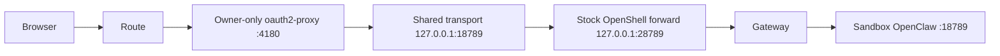

# Container Runtime Support: Docker and Podman

## Shared browser transport

VM and Kubernetes workspaces package the same
[`saw_ui_limit.py`](../charts/openshell-saw/files/installer/saw_ui_limit.py)
connection limiter. The VM embeds it in the signed installer; the independent
relay chart receives a generated byte-identical copy, checked by
`scripts/saw-profile-catalog.py --check`.

For Kubernetes workspaces the request path is:



The transport is a restricted Python container with only a read-only script
ConfigMap: no client secret, CLI session or Kubernetes token mount. It allows
16 upstream connections, reserving capacity below OpenShell's sandbox limit.
It starts Python with `-I` so the adjacent OIDC `token.py` helper cannot shadow
Python's standard-library `token` module during transport startup.
While the CLI restarts after an expired authentication token, the stable listener
queues connections with bounded retries **before sending any request bytes**.
The container's `--connect-only` mode never replays an HTTP request or WebSocket
frame, including a GET whose response was lost. VM transport behavior remains
unchanged.

Refreshing the CLI's on-disk token does not refresh an already running forward
session in the pinned stock release. Established WebSockets can therefore close
at expiry; clients must reconnect through their existing authenticated browser
session. The transport masks short connection-refused gaps for new connections,
not a failed token exchange or an indefinitely unavailable gateway. Qualification
must cross token expiry and verify reconnect, owner isolation and no duplicate
tool execution; passing a short chat does not establish that coverage.

## VM container runtimes

The gateway VM supports two container runtimes, selectable at deploy time via a single Helm value.
No golden image rebuild is required to switch — both images are pre-built and available.

## Runtimes

| Runtime | Golden image | Use case |
|---|---|---|
| `podman` (default) | `openshell-gateway` | NemoClaw fallback validation, openclaw, opencode, and external images |
| `docker` (legacy) | `openshell-gateway-docker` | Docker-only compatibility and internal-registry workflows |

## Choosing a runtime

The runtime is selected independently with `containerRuntime`. OpenClaw and opencode
use the selected OpenShell driver directly. NemoClaw first attempts its native
onboarding; with the currently validated release, Podman uses the OpenShell sandbox
fallback when that Docker-only preflight fails. Podman is the default because it is
rootless and included in Fedora.

Set `containerRuntime` to match:

```yaml
# Default deployment: rootless Podman + NemoClaw
containerRuntime: podman
onboardCli: nemoclaw
```

Docker remains available as an explicit legacy override:

```yaml
containerRuntime: docker
onboardCli: nemoclaw
```

## What changes between runtimes

### Golden image (`image-builder-charts/helm/openshell-gateway-image`)

| Step | Docker | Podman |
|---|---|---|
| Packages | Removes Podman, installs Docker CE | Keeps Fedora-default Podman |
| Runtime service | `docker.service` enabled | `podman.socket` enabled (user-level, rootless) |
| GRPC bridge IP | `172.17.0.1` (Docker bridge default) | `10.88.0.1` (Podman bridge default) |
| Sandbox driver env | `OPENSHELL_DRIVERS=docker` | `OPENSHELL_DRIVERS=podman` |

### Helm chart (`charts/openshell-saw`)

| Resource | Docker | Podman |
|---|---|---|
| DataSource | `openshell-gateway-docker` | `openshell-gateway` |
| cloud-init `OPENSHELL_DRIVERS` | `docker` | `podman` |
| Registry auth | `docker login` to internal OpenShift registry | skipped — external images only |
| Binary extraction | `docker pull/create/cp/rm` | `podman pull/create/cp/rm` |
| Dashboard systemd units | `/usr/bin/docker run` | `/usr/bin/podman run` |
| Sandbox pre-pull | `sudo docker pull` | `sudo podman pull` |

## Building the golden images

```bash
# Podman variant — default for NemoClaw fallback validation, openclaw, and opencode
make gateway-build-podman

# Docker compatibility variant (optional)
make gateway-build-docker
```

Each produces a separate ImageStream, DataVolume, and DataSource on the cluster.
Both can coexist in the same namespace.

## Deploying a sandbox

```bash
# Podman runtime + NemoClaw fallback validation (default)
make saw-create \
  OPENSHELL_SAW_NAME=my-sandbox \
  CONTAINER_RUNTIME=podman \
  PROVIDER=build MODEL=nvidia/nemotron-3.5-lightning-30b-a3b API_KEY=<nvapi-key>

# Docker compatibility runtime + NemoClaw
make saw-create \
  OPENSHELL_SAW_NAME=my-sandbox \
  CONTAINER_RUNTIME=docker \
  PROVIDER=build MODEL=nvidia/nemotron-3.5-lightning-30b-a3b API_KEY=<nvapi-key>
```

Switching an existing sandbox requires a values change and VM recreate:

```bash
helm upgrade <release> charts/openshell-saw --set containerRuntime=podman
# Then delete and recreate the VM by uninstalling and reinstalling the release.
```

## Connecting to the TUI

The gateway presents its own CA certificate on the Route. Users authenticate
with OIDC; the in-VM admin mTLS identity is temporary and must never be
copied to a laptop.

### Step 1 — Configure the CLI and sign in

```bash
export OPENSHELL_SAW_NAME=<your-saw-name>
make saw-configure
openshell gateway login "$OPENSHELL_SAW_NAME"
```

### Step 2 — Verify gateway and sandbox are reachable

```bash
openshell sandbox list
# Should show the sandbox in Ready or Unspecified phase
```

### Step 3 — Open the TUI

```bash
SANDBOX=<sandbox-name>
ssh \
  -o "ProxyCommand=openshell --gateway ${OPENSHELL_SAW_NAME} ssh-proxy --gateway-name ${OPENSHELL_SAW_NAME} --name ${SANDBOX}" \
  -o StrictHostKeyChecking=no \
  -o UserKnownHostsFile=/dev/null \
  -o LogLevel=ERROR \
  -tt sandbox@openshell-${SANDBOX}.default openclaw
```

See [Credential isolation](credential-isolation.md) for the distinction between
the short-lived installer admin identity and user access.

## Known limitations

**NemoClaw with Podman** is the APPENG-6276 validation target. The default deployment
uses rootless Podman; if onboarding or connect reports a Docker-only preflight failure,
capture that result as a validation blocker rather than switching the production default
back silently.

**Inference routing** follows the current SAW-BOM provider profiles. The
agent sends a nonsecret marker through the sandbox proxy and namespace
credential proxy; only the latter injects the real key on a bound HTTPS host. See
[deployment details](deployment-guide.md) for the current installer flow.

**The `nemoclaw-sandbox` image** must be reachable from the VM before the in-guest installer creates that sandbox. Either build it with `make sandbox-build` or mirror it from `ghcr.io/validatedpatterns-sandbox/nemoclaw-sandbox:latest` using `make images-mirror MIRROR_IMAGES=nemoclaw-sandbox`. The default BOM pulls this public GHCR image directly from the VM. See [Container images](container-images.md).

## Risks

- **Network namespace differences** — Docker uses `172.17.0.0/16`, Podman uses `10.88.0.0/16`. The GRPC endpoint is derived automatically at first boot.
- **Rootless vs rooted** — Podman runs rootless (user socket at `/run/user/1000/podman/podman.sock`). Dashboard containers using `podman run` may need `--userns=keep-id` for correct UID mapping.
- **Two images to maintain** — both golden images need rebuilds when the base Fedora version or OpenShell version changes.
