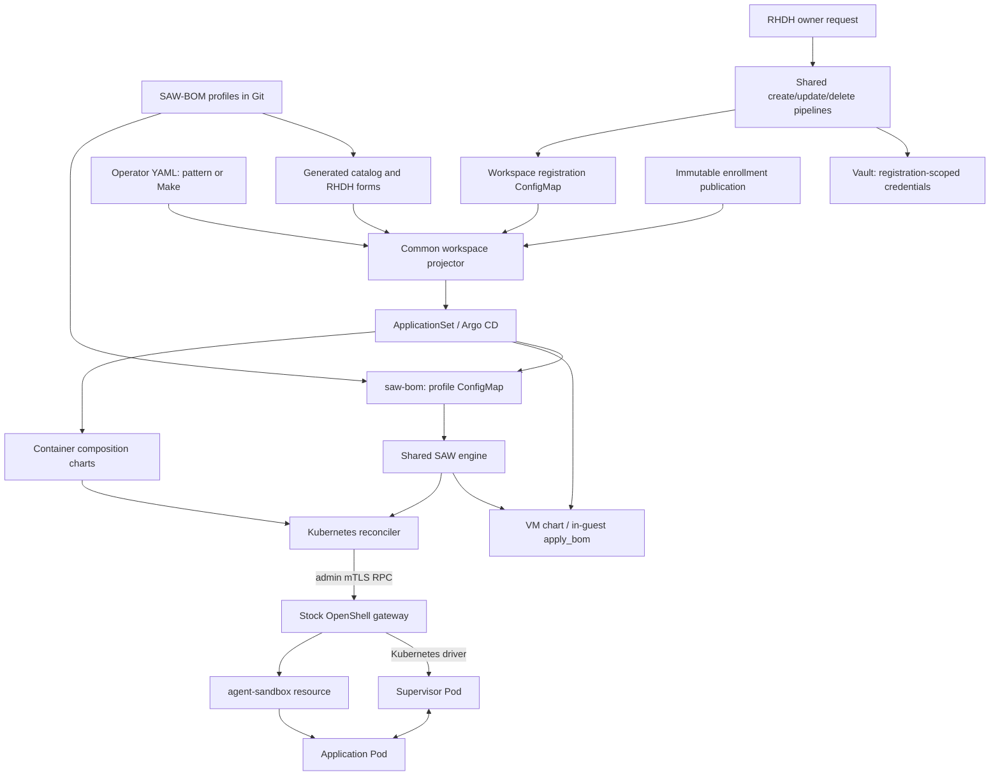
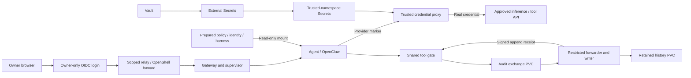

# Container workspaces

Container mode adds a Kubernetes backend to SAW's existing workspace lifecycle.
VM remains the default. Both backends consume the same SAW-BOM language, profile
catalog, provider profiles and tool-action policy. Container mode uses the stock
OpenShell Kubernetes driver; it does not add a workspace CRD or modify that driver.
See [installation and enablement](container-installation.md) for the pattern,
standalone Make and RHDH entry points, inputs and operational boundaries.

## Architecture and ownership



| Component | Responsibility and boundary |
|---|---|
| `saw-bom` | Publishes the same profile documents for either backend. A profile describes workspaces, providers, sandboxes, harnesses and inference inputs. |
| Shared `saw_core.py` | Owns profile parsing, validation, dependency ordering, provider selection, typed inference inputs and tool-gate bundle construction. VM and container adapters load the same source. |
| Shared `saw_admin.py` | Creates a temporary administrator identity for an operation and removes its private files afterward. The VM publishes temporary trust through its local file; the Kubernetes adapter updates one named public trust Secret. Both use the same certificate issuance and cleanup code. |
| VM `apply_bom.py` | Retains VM installation, Podman, guest files and VM-specific lifecycle operations. The signed installer embeds the shared engine bytes. |
| Common `workspace.py` | Projects a registration and catalog into `saw-users` values: sandbox topology, image overrides, approved profile digest, model inputs and public enrollment. Also implements shared readiness: matching BOM/intent generation, healthy Argo application and owner login challenge. It performs no credential storage or resource mutation. |
| RHDH adapter | Authenticates requests, resolves owners, stores provider inputs, maintains registration and drives the existing Tekton/ApplicationSet flow. Its forms come from the shared catalog. |
| Standalone projector | An ApplicationSet plugin installed by `saw-users` when `projection.enabled`. Uses the same `workspace.py` as RHDH, with operator-owned YAML instead of portal registrations. Reads named public enrollment ConfigMaps; has no Kubernetes write or Secret-read permission. |
| Container composition | Creates per-registration identity, network policy, credential proxy, gateway, PVCs, audit services, preparation Jobs, reconciler and browser relay through Argo CD. |
| Enrollment Job | Compares deployed resources against an administrator-approved boundary; records actual resource UIDs and hashes, PVC identities and public trust material in an immutable publication. It cannot approve an arbitrary observed configuration. |
| Kubernetes reconciler | Reads BOM + intent, checks the approved boundary and attachment identities, compiles stock OpenShell RPCs, and reconciles owned objects using a retained ledger. It does not create application Pods directly. |
| Stock gateway / driver | Implements workspace/provider/sandbox APIs and creates supervisor Pods and agent-sandbox resources. Gateway state has its own PVC. |
| Stock agent-sandbox controller | Reconciles the workload resource into the application Pod. Its CRD/controller is a separate prerequisite, not a SAW API. |
| Governance interceptor | Supplies signed provider profiles and policy. SAW's existing interceptor extension additionally restricts Kubernetes driver configuration to an approved PVC/resource envelope submitted by an admin mTLS identity. |
| Credential proxy | Resolves opaque credential markers using trusted-namespace Secrets and the shared provider policy. It supplies credentials only for approved destinations. |
| Audit writer | Owns retained history outside the application namespace and signs acknowledgements after append. The application mounts an exchange volume, not the history PVC. |
| Browser relay | Combines owner-only login, a dedicated nonadmin Keycloak client, shared connection limiter and stock OpenShell forwarding. Its membership is scoped to the intended workspace. Only its membership Job opens a temporary gateway administrator session; the UI has no administrator identity or trust-write permission. |

The implementation lives in `kubernetes-runtime/` and the `saw-kubernetes-*`,
`openshell-saw-kubernetes`, `saw-runtime-policies`, `saw-audit-writer`,
`saw-workspace-relay` and `saw-portal-container` charts. The last chart composes
existing component charts for both installation paths; its name does not imply
a dependency on Developer Hub or a second BOM dialect.

Each registration has a runtime namespace (`saw-<owner>`), a separate control
namespace (`saw-ctl-<registration>`), retained history
(`saw-history-<registration>`) and a browser namespace per UI sandbox. Gateway
administrator keys exist only in the controller or membership Job's memory-backed
volume in the control namespace. Controller state and provider Secrets stay in
that namespace. Gateway and supervisor have different service accounts and
network permissions from the application. Each workspace has its own gateway;
governance, Keycloak, Vault, Argo and agent-sandbox are shared platform services.

Provider creation is restart-safe: the ledger records a pending payload digest
and original generation before `CreateProvider`. After a lost response, the
reconciler reuses the request ID and accepts the stock gateway's durable receipt
only for the unchanged resource revision. It never infers credential ownership
from a redacted read. See [recovery and qualification](provider-driver-qualification.md).

The briefing harness mounts two subdirectories from existing approved PVCs:
the digest-named harness on the read-only gate PVC at `/sandbox/harness`, and
`briefing` on the writable workspace PVC at `/sandbox/briefing`. Governance
admits only these exact aliases in addition to the base mounts; it does not
allow arbitrary additional mounts, subpaths or volume sources.

## Configuration and policy distribution

There are two different BOMs: the **installer BOM** pins VM runtime components;
the **SAW-BOM profiles** describe the user's workloads. Sharing the latter does
not mean that a container runs the VM installer.

1. An operator commits approved profiles, component image digests, provider
   destinations and site topology. `make catalog` generates forms and catalogs,
   and mirrors canonical policy/projection sources into their packaging charts.
2. RHDH accepts the deployment mode and a profile allowed for that backend. The
   owner cannot supply a RuntimeClass, PVC name, executable image or policy
   override. Provider credentials go through the request Secret into Vault;
   registration stores references and permitted public metadata.
   A static installation supplies the same public registration and site values
   directly. Its operator provisions provider material in Vault; the projector
   never handles those credentials.
3. `saw-users` selects the backend. VM omission remains `vm`; a configured
   container entry selects the composition chart. An existing registration's
   backend cannot be changed implicitly by changing a chart default.
4. Argo creates the foundation. Enrollment verifies the approved configuration
   and publishes the registration binding. The generator reads only the named
   public publications and reprojects the values to enable runtime resources.
   A new site can set `automaticEnrollment.enabled: false` to deploy its
   foundation for review. Enabling enrollment requires approved reference
   hashes; discovery is not approval.
5. The reconciler requires a coherent BOM digest and intent generation, checks
   namespace/PVC UIDs and the live boundary, and then calls the gateway. It
   refuses stale, substituted or unsupported inputs rather than falling back to
   another backend.

```mermaid
sequenceDiagram
  participant Git as Operator / Git
  participant Argo as Argo CD
  participant Enroll as Enrollment Job
  participant Project as Workspace projection
  participant Runtime as Reconciler
  participant Gateway as OpenShell gateway
  participant Pod as Workload
  Git->>Argo: Approved profile + site + desired registration
  Argo->>Argo: Identity, network, proxy, gateway, PVCs, BOM
  Argo->>Enroll: Pinned bootstrap inputs
  Enroll->>Enroll: Check approved boundary and ownership
  Enroll->>Project: Immutable binding: UIDs, hashes, public keys
  Project->>Argo: Intent, preparation, controller, relay values
  Argo->>Runtime: BOM + intent + public gateway CA + ledger
  Runtime->>Runtime: Compile shared BOM; verify current boundary
  Runtime->>Gateway: Establish temporary admin mTLS trust
  Runtime->>Gateway: Reconcile owned workspace/providers/sandboxes
  Runtime->>Gateway: Withdraw temporary admin trust
  Gateway->>Pod: Stock Kubernetes driver and agent-sandbox controller
```

Policies protect different boundaries:

- **Governance policy/provider profiles** control OpenShell operations, provider
  endpoints and the permitted driver-config envelope. The SAW extension is
  maintained as ordinary Rust plus an explicit patch to the pinned interceptor
  example. The existing OpenShell v0.1.2 provider-annotation ordering workaround
  remains; this change does not claim an entirely unmodified interceptor.
- **OpenShift admission and network policy** constrain Pod roles, service
  accounts, placement and network reachability. A reconciler's permission to
  call the gateway does not bypass these controls.
- **Credential-proxy policy** derives from the same provider catalog and Helm
  helper used by VM mode; credentials are not copied into application Pods.
- **Tool-action policy** uses the same `tool-actions.yaml`, decision engine and
  OpenClaw hook as VM mode. The Kubernetes adapter changes storage and audit
  transport, not the decision rules.

### Administrator sessions and retained identity

The controller and relay membership Job reuse the VM installer's per-operation
identity mechanism. There is no retained administrator certificate to renew and
no new certificate service. Each operation creates a one-day P-256 CA and
`OU=openshell-admin` client certificate in a memory-backed `emptyDir`. The CA
private key is destroyed immediately after signing; the client key is removed
when the operation exits.

```mermaid
sequenceDiagram
  participant Client as Controller / membership Job
  participant Shared as Shared admin-session code
  participant API as Kubernetes API
  participant Gateway as Stock gateway
  Client->>API: Wait for this exact Pod UID to become Running
  Client->>Shared: Create temporary identity in tmpfs
  Shared-->>Client: Client key/certificate + public session CA
  Client->>API: CAS update named client-ca Secret: add public CA
  API-->>Gateway: Project updated ca.crt volume
  Gateway->>Gateway: Reload TLS trust
  Client->>Gateway: Wait for authenticated RPC; perform operation
  Client->>Gateway: Close client channel
  Client->>API: CAS update: remove this session CA
  Client->>Shared: Remove private session files
```

The Kubernetes adapter retains concurrent sessions using `resourceVersion`
compare-and-swap. Each entry is bound to its originating Pod UID and certificate
expiry. A per-Pod file lock serializes operations. After a container restart in
the same Pod, the next operation withdraws that Pod's abandoned entries and
removes its old private files from `emptyDir` before issuing a new identity.
At startup, the process can precede kubelet's published `Running` phase. The
adapter waits up to 30 seconds while its exact Pod UID is `Pending`, then issues
the identity only after observing `Running`. Missing, replaced, deleting or
terminal Pods and API failures stop the operation. Publication still rechecks
the holder; this wait does not authorize trust for a Pending Pod.
Private-file cleanup also runs when trust recovery cannot reach the API.
Updates prune expired sessions and sessions whose Pod has exited or been
replaced. If cleanup loses API access, the next successful trust update removes
the abandoned entry; the certificate's one-day validity also bounds acceptance
on new connections. Secret volume propagation is asynchronous: publication is
followed by an authenticated probe, not an assumed immediate reload. Withdrawal
closes the caller's connection and removes its key; it is not instantaneous
revocation of connections already held by another process.

Only the controller and membership Job can read/update the named public
`<gateway>-client-ca` Secret. They can read Pod metadata in their trusted namespace
to verify session holders. These permissions confer gateway administrative
authority and are not granted to application or browser service accounts. The
bootstrap Job preserves active sessions when rechecking identity projections.

Gateway server TLS, JWT signing keys and the credential-encryption key remain in
the create-once retained identity bundle; opening an admin session does not rotate
them, alter workspace IDs, or interrupt the gateway. The public server CA is
projected separately as an immutable ConfigMap. The VM embeds both shared modules
inside its existing signed `apply_bom.py`, preserving the signed manifest format.

## Inference, tools and browser data paths



Model selection is public configuration; API keys and refresh material are not.
The compiler resolves an explicitly attached provider and an approved endpoint.
OpenAI-compatible agent inference currently supports NVIDIA, OpenAI and the
approved custom-inference path; unsupported combinations fail explicitly.

The container startup publishes whole managed OpenClaw configuration subtrees
through stock `openclaw config set --batch-file`, the same native writer used
by VM configuration commands. It preserves OpenClaw's metadata and backup
bookkeeping; directly replacing `openclaw.json` can trigger recovery of an older
model selection. Managed gateway, provider, agent and tool/plugin settings are
replaced together so removed permissions or providers do not survive an update.

An explicit container model uses an internal OpenClaw provider ID such as
`saw-openai/gpt-4.1`. This prevents the stock built-in model catalog from
rewriting a requested model to a different release. The BOM still names
`openai`; its approved OpenAI endpoint, protocol, credential marker and proxy
authorization are unchanged. Chat transcripts therefore identify the internal
provider alias and the exact requested model. VM native onboarding remains
unchanged. The native writer regression can run against a stock binary with
`node tests/openclaw-config-publication.mjs`; add `--expect-restore` on versions
that restore configurations missing metadata. It uses synthetic credentials in
temporary state and sends no inference requests.

The application receives its writable workspace, a read-only prepared gate and
optional harness, and an audit exchange. The writer's history and signing key
remain outside its mounts. A missing/invalid acknowledgement blocks the gated
operation. This is an application-hook control and an append receipt, not proof
that arbitrary code inside a compromised application cannot perform other
operations. Do not equate a recorded approval request with a completed tool
execution or a recorded final human decision.

## Lifecycle and installation surface

RHDH uses the existing create/update/delete forms and pipelines, with a backend
selector and backend-approved profile choices. The registration carries the
backend so status, readiness, restart and cleanup select the matching adapter.
Model changes use versioned public input publication; stop/start retains
workspace storage. Foreground deletion removes owned compute and access
resources while audit history is retained. Old registrations cannot claim a new
registration's resources or credentials.

Preparation/enrollment/relay Jobs have input-derived names and immutable script
ConfigMaps. A changed image or input creates a new Job rather than editing an
immutable PodSpec. Changing an enrolled security boundary still requires explicit
review; a new Job name does not authorize adopting new identities or overwriting
an existing trusted bundle.

| Entry point | Current boundary |
|---|---|
| Existing VM pattern and Make quickstart | Retain their existing installation path and default behavior. |
| RHDH container lifecycle | Uses the shared catalog, requests, pipelines and workspace projector; requires an operator-provided container site and approved profile boundary. |
| Static `saw-users` container values | Set `projection.enabled: true`. A read-only ApplicationSet plugin incorporates enrollment and relay publications continuously. VM entries keep their existing root-chart path. |
| Container Make entry point | `DEPLOYMENT_MODE=container` dispatches create/status/delete to the same `saw-users` installation. Argo owns its component applications. Requires the shared platform services and site inputs. |

RHDH container enablement requires `portal.deploymentModes: [vm, container]` and a
`portal.containerSites.<owner>` entry with the resolved subject, approved profile
digests, component revisions/images, network/storage inputs, reviewed boundary
references, and relay identity settings. Provider keys remain in Vault, with
External Secrets projections into the trusted namespace. The site must provide
both RWO storage and a filesystem class suitable for the shared preparation and
audit exchange mounts. Enabling the selector alone does not provide these inputs.

The runtime image packages the reconciler, pinned OpenShell protobuf SDK,
preparation helpers and canonical shared sources. The existing image publication
actions build it on amd64/arm64 and publish on `main`; sites consume the resulting
digest. For an operator build using an explicitly selected registry:

```sh
podman build --ignorefile kubernetes-runtime/Containerfile.dockerignore \
  -f kubernetes-runtime/Containerfile \
  -t "$REGISTRY/saw-kubernetes-runtime:$REVISION" .
podman push "$REGISTRY/saw-kubernetes-runtime:$REVISION"
```

The build context allowlist excludes local credentials and unrelated files.
Resolve and pin the pushed manifest digest in the site inputs; the build commands
alone do not install the component stack.

## Current boundaries

- Container installation adds OpenShift GitOps/ApplicationSet, Agent Sandbox,
  native admission and enforced network-policy requirements. The Make command
  checks platform APIs; it does not install, replace or adopt shared operators.
- A profile is enabled only with an owner-specific approved boundary and pinned
  BOM digest. Adding a BOM does not automatically approve its images, provider
  endpoints or storage permissions. One approved profile may contain several
  sandboxes; a registration selects one profile and one deployment backend.
- Source and image updates use ordinary Argo reconciliation; there is no second
  upgrade manager. Changes to an enrolled boundary or trusted bundle do not gain
  approval merely because a new image or Job revision exists.
- The browser path is owner authenticated. External gateway CLI access requires
  an explicitly configured passthrough Route and matching server certificate
  SAN. VM guest-management commands do not operate on container workspaces.
- An application-level tool hook and signed audit receipts are not kernel-level
  confinement. Retained history is isolated from the workload; cluster and
  storage administrators remain trusted.
