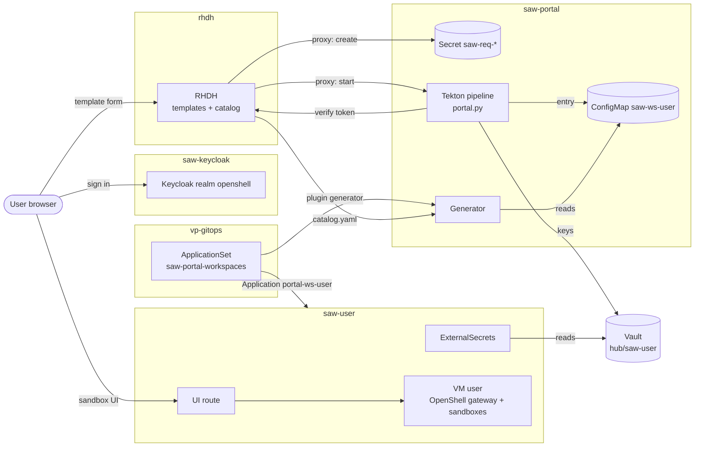
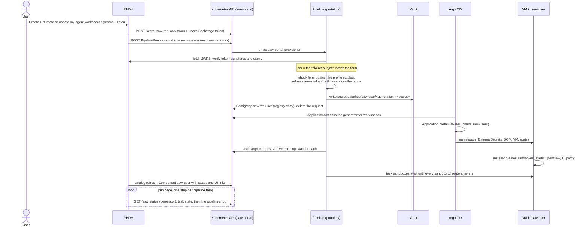
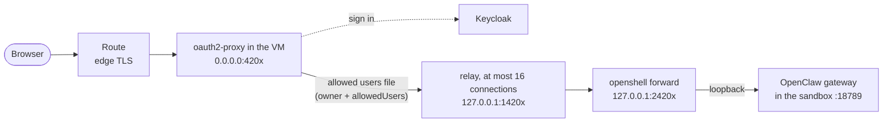

# Self-service agent workspaces (RHDH)

Users create their own Secure Agent Workspace from Red Hat Developer Hub
(RHDH). They pick a SAW-BOM profile, enter the keys that profile needs, and
get namespace `saw-<user>` with a VM, the profile's OpenShell sandboxes, and
routes to the sandbox web UIs. Nothing goes into Git: the keys go to Vault,
and the workspace is an entry in an in-cluster registry that Argo CD builds.

The step-by-step walkthrough and manual test is in [rhdh-user-guide.md](rhdh-user-guide.md).

This replaces the Helm-install flow of PR #33 (RHDH portal, by @pmatouse) with
the pattern's current way of creating a workspace, the `saw-users` chart.

## Components

| Component | Where | What it does |
|---|---|---|
| Red Hat Developer Hub | namespace `rhdh`, `Backstage` CR `developer-hub` (RHDH operator) | The portal. Shows the two templates (create, delete) and one catalog entry per workspace. Users sign in with Keycloak. |
| Keycloak realm `openshell` | namespace `saw-keycloak` | One identity for RHDH, the OpenShell gateway and the sandbox UIs. No self-registration; an admin adds users with generated passwords. Client `rhdh` (confidential) for RHDH, `openshell-dashboard` (public, PKCE) for the web UIs. |
| Request API | RHDH proxy endpoints `/saw-requests`, `/saw-pipelineruns` | The only cluster changes the templates make: create a request Secret, start a pipeline. They use RHDH's service account `rhdh-portal`, which can only *create* those two kinds in `saw-portal`. A third endpoint, `/saw-status` (GET), reads progress from the generator. |
| Portal pipelines | namespace `saw-portal`, Tekton `saw-workspace-create` / `saw-workspace-delete` | Run `portal.py` as service account `saw-portal-provisioner`. The first task verifies who the request is for and writes the keys and the registry entry (or marks it for deletion and deletes the Application); each later task waits for one stage of what Argo CD does, so a workspace's whole life shows as one pipeline. |
| Tekton tab | RHDH Kubernetes and Tekton plugins, service account `rhdh-kubernetes-reader` | Each workspace's catalog page shows its create and delete pipeline runs (label `backstage.io/kubernetes-id: saw-<user>`) as a graph with each task's log. Reads only `saw-portal`. |
| Admission policies | `ValidatingAdmissionPolicy` `saw-portal-*` | Pin what `rhdh-portal` may create (Secrets `saw-req-*`, PipelineRuns of the two pipelines with one parameter) and which Argo CD applications the provisioner may delete (`portal-ws-*`, labelled as the portal's). |
| Workspace registry | ConfigMaps `saw-ws-<user>` in `saw-portal` (label `saw.redhat.com/workspace=true`) | One entry per workspace: user name, profile, values for the `saw-users` chart. |
| Generator | Deployment `saw-workspaces-generator` in `saw-portal` | Reads the registry (a malformed entry is skipped and logged). Serves the Argo CD ApplicationSet plugin API (token), the RHDH catalog with each workspace's status (`/catalog.yaml`, no token) and the progress the create template follows (`/status`, the user's Backstage token, through the RHDH proxy endpoint `/saw-status`); a NetworkPolicy admits only RHDH and Argo CD. |
| ApplicationSet `saw-portal-workspaces` | Argo CD namespace (`vp-gitops`) | One Application `portal-ws-<user>` per registry entry, rendering `charts/saw-users` for that one user. Creates and updates only; deleting is done by the delete pipeline. |
| `saw-users` -> `openshell-saw` | namespace `saw-<user>` | The same charts as a Git-declared user in `overrides/saw-users.yaml`: External Secrets for the user's keys, the BOM, the VM, the gateway and UI routes. |
| Vault | `secret/data/hub/saw-<user>/<generation>/<secret>` | The user's keys, under the registration's generation (a new one per registration, so a deleted workspace's cleanup never reaches a replacement's keys). The provisioner writes them through the `hub` Kubernetes auth mount with role `saw-portal-writer`, whose policy covers only `secret/*/hub/saw-*` (every portal user's path: the token check in `portal.py` keeps a request to its own). |
| In-VM installer | `apply_bom.py` in the VM | Creates the sandboxes, starts OpenClaw, and runs one OAuth proxy and one port forward per sandbox UI. |
| Cleanup | CronJob `saw-portal-cleanup` | Deletes request Secrets that no pipeline handled. |

## How it works

```
RHDH  "Create or update my agent workspace" (charts/openshell-rhdh)
  │  proxy /saw-requests      Secret saw-req-*: the form + the user's Backstage token
  │  proxy /saw-pipelineruns  PipelineRun saw-workspace-create, request=saw-req-*
  ▼
Tekton (namespace saw-portal)  portal.py create
  │  1. verify the Backstage token (ES256 signatures, RHDH's JWKS): the user it acts for
  │  2. check the form against the profile catalog
  │  3. Vault  secret/data/hub/saw-<user>/<generation>/<secret>  (Kubernetes auth, role saw-portal-writer)
  │  4. ConfigMap saw-ws-<user>, label saw.redhat.com/workspace=true: the registry entry
  ▼
ApplicationSet saw-portal-workspaces (plugin generator: portal.py serve; create and update only)
  │  Application portal-ws-<user> → charts/saw-users with that one user
  ▼
saw-users → namespace saw-<user> (label saw.redhat.com/portal=true)
            saw-<user>-secrets (External Secrets from the entry's vaultPrefix)
            saw-<user>-bom, saw-<user> (the VM), exactly as for overrides/saw-users.yaml
```

Overall flow:



Creating a workspace (Argo CD builds it; the pipeline watches it after its first task):



The generator also serves the RHDH catalog (`/catalog.yaml`, without a
token: RHDH reads it as a plain catalog location; it lists user and profile
names only, and a NetworkPolicy lets only RHDH's and Argo CD's namespaces
reach the generator): one `Component` per workspace,
owned by its user, with its status (below), links to the OpenShell web UI
(which lists the OpenShell workspaces the user is a member of: the
generator fills a portal entry's `ownerSubject` with the user's Keycloak id,
and the installer adds that subject to each workspace),
each sandbox web UI, and the delete template.

### Progress

Each pipeline is the whole life of the request, one task per stage (Argo CD
still does the building and the removing; the tasks after the first only
wait for it): create `register` → `argo-cd-apps` → `vm` → `vm-running` →
`sandboxes`; delete `unregister` → `argo-cd-removes` → `finish`. The first
task hands the user to the others as the Tekton result `user`. Runs are
labelled `backstage.io/kubernetes-id: saw-<user>`, so RHDH's Tekton tab on
the workspace's catalog page (Kubernetes and Tekton plugins,
`rhdh.tekton`, as `rhdh-kubernetes-reader`: read only, `saw-portal` only)
shows them. The first task refuses a run labelled for another user.

The templates' run pages show one step per task, then the log. The steps
call the generator's `/status` through the RHDH proxy endpoint `/saw-status`
(GET only), with the user's Backstage token in `X-Saw-Token`:

| Call | Answers |
|---|---|
| `GET /status/run/<pipelinerun>[?task=<task>]&wait=20` | the run's phase, each task's state and its log, for the user who made the request and for administrators (once the log shows who that was; anyone else gets 404); with `task`, waits for that task |
| `GET /status/workspace?for=<stage>&wait=20` | the caller's workspace: `registered` (registry entry), `apps` (the four Argo CD applications), `vm` (VirtualMachine defined), `running`, `ready` (every sandbox UI route answers, i.e. the installer finished) |
| `...&assert=1` / `assert=ready` | 422 when the run failed or did not end / the workspace failed or is not ready, so the step fails |

`wait` holds the answer until the stage is reached, a stage fails (Argo CD
sync `Failed`/`Error`, VM `DataVolumeError`, `CrashLoopBackOff`,
`ErrorPvcNotFound`) or the wait passes (20 s in the templates: they reach RHDH through its route, and the OpenShift router drops a request quiet for 30 s); the template repeats each wait step
(`each`) up to the task's time limit. The workspace is
the caller's own (the token names it); only administrators may add
`&user=<name>` to read another user's.
Status reads accept a token up to two hours after it expires (the token is
issued when the run starts; reads change nothing).

The generator reads, for this: the portal's PipelineRuns and pod logs in
`saw-portal`, Applications in the Argo CD namespace, and VirtualMachines
(get only, cluster-wide since namespaces `saw-<user>` come and go). The same
status is in each catalog entity's description and the annotation
`openshell.pattern/status`.

### Administrators

Users in `portal.admins` see two templates and only those: **Create or update
an agent workspace for a user** (the same form plus a user name, one user at a
time; the admin enters that user's keys) and **Delete a user's agent
workspace** (lists every workspace). An administrator who wants a workspace of
their own enters their own name. The request carries `forUser` (create) or the
chosen workspace (delete); the pipeline takes the caller from the token as
always and acts for another user only when the caller is an administrator.
The run's log says `create request saw-req-… from admin for carol`; the run is
on carol's Tekton tab, and the admin can follow it (the status endpoint
answers about another user's workspace for administrators only). The user
must exist in Keycloak to sign in (`make -f Makefile-quickstart
keycloak-add-users`).

Create is also update: for a user who has a workspace, it rewrites the
registry entry and the keys in Vault, and Argo CD applies the new profile.

RHDH RBAC (`rhdh.rbac.enabled`, on) shows each user what applies to them:

| Who | Role (group) | Sees |
|---|---|---|
| every user | `saw-user` (Keycloak `saw-users`) | their own workspace; **Create or update my agent workspace** (templates without an audience label) |
| users without a workspace | `saw-new` (`saw-without-workspace`) | the **Get started** card (label `saw.redhat.com/new-users`) |
| users with a workspace | `saw-owner` (`saw-workspace-owners`) | **Delete my agent workspace** (label `saw.redhat.com/owners`) |
| `portal.admins` | `saw-admin` (by user) | every entity but templates, and the admin templates (label `saw.redhat.com/admin`) |

The generator publishes the two workspace groups in its catalog (it reads the
realm's users from Keycloak with the `rhdh` client's service account; the
secret comes from Vault as `saw-generator-keycloak`), so they switch within
about a minute of a create or delete. The **Get started** card
(Component `saw-get-started`) links to the create action: RHDH's own
empty-state button leads to `/catalog-import`, a page users may not open. The
workspace's page links the delete form with the workspace already chosen.

Every user but the administrators gets `saw-user` through the Keycloak group
`saw-users`: the `saw-rhdh-keycloak-client` job makes it the realm's default
group, adds the existing users, removes the administrators, and lets the
`rhdh` client's service account read users and groups, which RHDH's Keycloak
catalog provider imports every two minutes (a new user sees the portal after
that). Administrators are kept out of every user group (the job, and the
generator for its two groups) because RHDH RBAC joins the conditions of all a
user's roles: in a user group, an administrator would see the user templates
as well. An administrator added to Keycloak later is in `saw-users` until the
job runs again (the next sync). The pipeline checks `portal.admins` itself, so
hiding is not what protects the admin actions.

### Who a request is for

RHDH's proxy endpoints can be called by any signed-in user, so the pipeline
does not trust anything the template writes about the user. It takes the user
only from the request's Backstage token (`secrets.backstageToken`). On RHDH's
current backend that is a plugin token: signed by the scaffolder (JWKS at
`/api/scaffolder/.backstage/auth/v1/jwks.json`), `sub` scaffolder, `aud`
catalog, with the user in `obo`, a limited user token signed by the auth
backend (`/api/auth/.well-known/jwks.json`). The pipeline verifies both
signatures and expiries (a full user token from an older backend is verified
against the auth keys alone). A user can therefore create, update or delete
only their own workspace, and a request names its action (a create request
cannot run the delete pipeline). Admission policies in `saw-portal` limit
what RHDH's service account (`rhdh-portal`) can create (or, should its Role
ever allow it, update) there: Opaque Secrets
named `saw-req-*`, and PipelineRuns of the two portal pipelines, as the
provisioner, with the single parameter `request=saw-req-*`. A request is
deleted when it has been handled, refused when older than an hour, and
removed by the CronJob `saw-portal-cleanup` if no pipeline ever handled it.

A workspace is refused when its namespace exists without the portal label
(the user is in `overrides/saw-users.yaml`), when one of the Argo CD
applications it needs belongs to someone else, or when the user name ends in
`-bom` or `-secrets` (its apps would take another user's names; `saw-users`
refuses such names too).

The ApplicationSet only creates and updates Applications, and keeps them if
it is deleted: a registry problem never deletes a VM. A malformed registry
entry is skipped and logged, so it cannot stop everyone else's updates; the
generator's `/healthz` lists it (`skippedRegistryEntries`). Its workspace
keeps running unchanged until the entry is fixed. The delete pipeline
deletes the user's Application `portal-ws-<user>` itself; an admission policy
lets the provisioner delete only Applications labelled as the portal's. (The
per-ApplicationSet `applicationsSync` policy applies unless the ApplicationSet
controller runs with a global `--policy`; the default allows it.)

### Profiles and form fields

`scripts/saw-profile-catalog.py` reads `charts/saw-bom/profiles` and writes:

- `charts/saw-users/files/profile-catalog.json` and
  `charts/openshell-rhdh/files/profile-catalog.json`: each profile's
  workspaces and sandboxes (with their UI flag), and each Secret its providers
  read with the fields it needs (`credentialSecretKey`, and `baseUrlSecretKey`
  / `modelSecretKey` when set);
- `charts/openshell-rhdh/files/create-workspace.yaml`: the RHDH template. It
  lists the profiles, and for the chosen one asks only for its fields. API
  keys use RHDH's Secret field, so they are not stored with the task.

Run it after changing a profile. `tests/charts/test_saw_users_chart.py`
fails when the files are stale.

The pipeline adds each Secret's `provider` so the installer can refuse a key
for another service. A native API's Model field is an optional override:
leaving it blank stores no model in Vault, so the installer uses the provider
profile's `default_model`. The catalog generator checks the provider profiles
for an available default but does not copy its value into the form or Secret.
Custom endpoints must supply their own model.

### Keys

A portal workspace's `vaultPrefix` is `secret/data/hub/saw-<user>/<generation>`.
The generation is a random ID given to each new registration (a create with no
registry entry); updates keep it, so the keys stay where they are for as long
as the entry lives. It sits under the hub prefix, so the existing
`vault-backend` store already reads it. Entries from before generations keep
`secret/data/hub/saw-<user>`.
`pattern-secrets` syncs only the Secrets the user's profiles read, and the
SSH key always from the shared `secret/data/hub/ssh`.

To write there, the pipeline logs in to Vault as its service account
(`saw-portal-provisioner`) through the `hub` Kubernetes auth mount, with the
role `saw-portal-writer`. The role's policy allows only
`secret/data/hub/saw-*` and `secret/metadata/hub/saw-*`: any portal user's
path, not one user's. Vault cannot tell the users apart (one provisioner
writes for all of them); what keeps a request to its own user's path is
`portal.py`, which takes the user only from the verified Backstage token
(there is no setting to trust the form instead). The imperative job
`saw-portal-vault` creates the policy and the role through Vault's HTTP API
with the pattern's root token (`ansible/playbooks/saw-portal-vault.yaml`).
Without the imperative framework, run
`make portal-vault-setup` once as a cluster admin.

Deleting a workspace also deletes its keys (`portal.deleteVaultSecrets`): the
keys of the entry's generation only. A delete's cleanup can be overtaken after
it has checked that the entry is still its own (a later delete takes over and
finishes, then a create registers a replacement); the replacement has a new
generation, so the older cleanup cannot destroy its keys.

## TLS

Every connection the portal makes is verified. RHDH, the generator and the
Keycloak setup Job build a CA bundle when their pod starts
(`files/ca-bundle.py`, an init container): the image's system CAs, the
cluster's trusted CA bundle (`config.openshift.io/inject-trusted-cabundle`:
proxy CAs), the Kubernetes API and service CAs, the router's CA
(`openshift-config-managed/default-ingress-cert`, for Keycloak's route when
the default ingress certificate is self-signed) and `tls.extraCaBundle`.
RHDH's Node runtime adds it with `NODE_EXTRA_CA_CERTS`; its proxy endpoints
(`secure: true`) and Kubernetes plugin (`caFile`, the service account's CA)
verify. The pipeline checks Vault's certificate against the service CA.
`tls.insecureSkipVerify: true` turns all of it off, for a throwaway test
cluster only.

## Sandbox web UIs

The path from the browser to OpenClaw:




A sandbox in a SAW-BOM `sandbox.yaml` can publish its agent's web UI (the
OpenClaw control UI, also in NemoClaw sandboxes):

```yaml
- name: notebook
  type: openclaw
  ui:
    route: true
```

The `data-science` profile does this for the default workspace's `notebook`.
It works for every workspace, from the portal or from `overrides/saw-users.yaml`:

- `saw-users` numbers the user's UI sandboxes (sorted by
  `<workspace>/<sandbox>`, at most 8) and passes them to `openshell-saw` as
  `sandboxUi`, each with a proxy port (4201+) and a forward port (14201+).
- `openshell-saw` adds the route `<user>-<workspace>-<sandbox>-ui`, a VM and
  Service port for the proxy, and registers the route's callback on the
  Keycloak client `openshell-dashboard`.
- In the VM, the installer lets the sandbox's control UI accept the route's
  origin (`gateway.controlUi.allowedOrigins`), keeps the OpenClaw gateway
  listening on 0.0.0.0 in the sandbox (`--bind lan`), and runs three user units
  per UI:
  - `saw-ui-forward-<ws>-<sb>`: `openshell forward service` from VM
    127.0.0.1:2420x to the sandbox's port 18789;
  - `saw-ui-limit-<ws>-<sb>`: a small TCP relay on 127.0.0.1:1420x that lets
    at most 16 connections through to the forward and queues the rest
    (OpenShell refuses more than 20 forward connections per sandbox,
    NVIDIA/OpenShell#3494; found live, the control UI's burst of requests
    went past that and came back as 502/504 after 30 s);
  - `saw-ui-proxy-<ws>-<sb>`: oauth2-proxy on 0.0.0.0:420x, what the route
    reaches. It signs in with Keycloak (PKCE) and admits only the users in
    `sandbox-ui-users`: the workspace owner (Keycloak `preferred_username`)
    and `sandboxUiProxy.allowedUsers`.
- The route is labelled `saw.redhat.com/oidc-redirect=true`. Its callback,
  `https://<host>/oauth2/callback`, has to be on Keycloak's
  `openshell-dashboard` client before anyone can sign in. The redirect
  registrar in Keycloak's namespace adds it within about 15 seconds of the
  route appearing; with the registrar off, an administrator runs
  `make -f Makefile-quickstart keycloak-register KC_USER=<user>` once the
  workspace exists. See the README's
  [Web UI sign-in](../README.md#web-ui-sign-in-redirect-uris).

The UI ports are VM interface ports, so adding or removing a UI takes a VM
restart (`make saw-restart`).
`make sandbox-ui OPENSHELL_SAW_NAME=<user>` prints
each UI's URL.

### One sign-in: OpenClaw trusted-proxy auth

The Keycloak sign-in is the only one. A UI sandbox's gateway runs in
OpenClaw's [trusted-proxy mode](https://docs.openclaw.ai/gateway/trusted-proxy-auth)
(`sandboxUiProxy.trustedProxy.enabled`, default on):

- oauth2-proxy sends the signed-in user's Keycloak `preferred_username` as
  `X-Forwarded-Email` (its `OIDC_EMAIL_CLAIM`, the name it checked against
  the allowed users), overwriting any value the browser sent; its
  `X-Forwarded-User` is the Keycloak subject, a UUID, so OpenClaw's
  `userHeader` is `x-forwarded-email`;
- the gateway accepts it only from `gateway.trustedProxies` (loopback, where
  `openshell forward service` delivers the request) and only for
  `allowUsers`, the users the proxy admits; anything else reaching port
  18789 (another pod, a direct connection) has no identity and is refused;
- the signed-in user's browser is approved as a Control UI device without
  pairing (`deviceAutoApprove`);
- the CLI, the TUI and `openclaw agent` in the sandbox use the gateway secret
  as `gateway.auth.password` and need nothing new. (OpenClaw's
  `config set` removes that password in trusted-proxy mode,
  openclaw/openclaw#162216; the installer writes it back into the config
  file after its last `config set` and passes it to the gateway as
  `OPENCLAW_GATEWAY_PASSWORD`.)

The gateway secret is made once in the sandbox and kept (the installer never
sees it), and every installer run restarts the gateway so a changed mode or
user list applies. Sandboxes without a UI route keep token auth.

What it trusts: a process inside the sandbox, or a user logged in to the VM,
can reach the gateway over loopback and set the header itself. Both can
already read the gateway secret, so this gives them nothing new. With the
setting off, the UI asks for the token and `make sandbox-ui` prints it in the
URL.

With one sign-in, the Keycloak password is all that protects a UI. The
realm has no default passwords, a strong-password policy and brute-force
lockout, and no self-registration (README, "Keycloak production and demo users"); on a
realm imported earlier, run `make keycloak-harden`
once. Only users an admin adds can sign in to RHDH and request a workspace:
`make keycloak-add-users` creates the accounts for
the names in `overrides/saw-users.yaml` (`USERS_FILE=` for another list).

To check after a sync: open the UI route, sign in with Keycloak, and the
control UI connects without asking for a token. In the sandbox,
`openclaw gateway status` and `openclaw tui` still connect.

## Setup

The pattern installs it with `values-prod.yaml`:

- namespaces `rhdh` and `saw-portal`, the RHDH and OpenShift Pipelines
  operators;
- the `openshell-rhdh` application (namespace `rhdh`);
- the imperative job `saw-portal-vault`.

Before the first sync:

1. Load the RHDH OIDC secrets into Vault (`rhdh-oidc` in
   `values-secret.yaml.template`, generated):
   `./pattern.sh make load-secrets`.
2. Check that the pattern's Argo CD runs the ApplicationSet controller:
   `oc get argocd -n vp-gitops -o jsonpath='{.items[0].spec.applicationSet}'`
   must not be empty.

A PostSync Job creates or updates the Keycloak client `rhdh` (confidential,
redirect `https://<rhdh>/api/auth/oidc/handler/frame`) with the secret from
Vault, also in a realm that existed before.

RHDH is at `https://backstage-developer-hub-rhdh.apps.<cluster domain>`. Sign in
with a realm user; user names must be lowercase DNS labels of at most 19
characters (they name the VM).

## Settings (`charts/openshell-rhdh/values.yaml`)

| Value | Default | |
|---|---|---|
| `portal.pruneOnRemove` | `true` | deleting a workspace deletes its VM and namespace |
| `portal.deleteVaultSecrets` | `true` | deleting a workspace deletes its keys |
| `portal.generator.networkPolicy` | `true` | only RHDH and Argo CD may reach the generator |
| `rhdh.rbac.enabled` | `true` | Backstage RBAC: users see the user actions and their own workspace; admins everything (needs RHDH's Keycloak catalog provider, `rhdh.rbac.keycloakCatalogPlugin`) |
| `portal.admins` | `admin` | users who may create or delete a workspace for another user (the "… for a user" templates); empty: no admin templates |
| `rhdh.homePage.enabled` | `true` | home page with only "Actions" (the create and delete templates) and "Workspaces" (the catalog); `rhdh.homePage.titles` renames the sections |
| `rhdh.hiddenMenuItems` | `default.apis`, `default.learning-path` | sidebar entries hidden (the portal does not use them) |
| `rhdh.branding.title` | `Secure Agent Workspace Self Service` | product name in the header and browser tab; logo `files/logo-{light,dark}.svg` |
| `rhdh.disabledPlugins` | TechDocs, quickstart | RHDH plugins turned off (the Docs entry, the "Let's get you started" drawer) |
| `rhdh.tekton.enabled` | `true` | the Tekton tab on each workspace (RHDH Kubernetes and Tekton plugins) |
| `vault.addr`, `vault.authMount`, `vault.role` | `https://vault.vault.svc:8200`, `hub`, `saw-portal-writer` | |
| `applicationSet.namespace` | `global.vpArgoNamespace` | where the ApplicationSet lives |
| `sawUsers` | `{}` | extra `saw-users` values for portal workspaces |

## Names

| Thing | Name |
|---|---|
| Namespace | `saw-<user>` (label `saw.redhat.com/portal=true`) |
| VM | `<user>` |
| Argo CD applications | `portal-ws-<user>` -> `saw-<user>-secrets`, `saw-<user>-bom`, `saw-<user>` |
| Registry entry | ConfigMap `saw-ws-<user>` in `saw-portal` |
| Keys | `secret/data/hub/saw-<user>/<generation>/<secret>` (e.g. `inference`, `web-search`); the entry's `vaultPrefix` names the generation |
| OpenShell web UI | `https://<user>-webui-saw-<user>.apps.<domain>` |
| Sandbox UI | `https://<user>-<workspace>-<sandbox>-ui.apps.<domain>` |
| RHDH | `https://backstage-developer-hub-rhdh.apps.<domain>` |

User names are lowercase DNS labels of at most 19 characters (they name the VM).

## Status

Checked on a live cluster (OpenShift with RHDH operator 1.10, OpenClaw 2026.9.5):

- the Keycloak changes: policy, lockout, registration off, generated
  passwords, adding and resetting users;
- the sandbox UI: the Keycloak sign-in through the route, the owner admitted
  and another user refused by oauth2-proxy;
- the RHDH `Backstage` resource against the operator's `v1alpha4` and
  `v1alpha5` schemas;
- the installer across VM restarts.

The [user guide](rhdh-user-guide.md) walks through these checks. The parts
still to confirm on a cluster are listed under
[Limits and open items](#limits-and-open-items).

## Limits and open items

- With `rhdh.rbac.enabled=false`, every signed-in user sees every workspace
  entity and its Tekton tab (names, links and pipeline logs, never keys) and
  the admin templates (the pipeline refuses them).
- Any realm user can request a workspace: with RBAC on, every member of
  `saw-users` (the realm's default group) gets the user role. Users are
  added by an admin (`keycloak-add-users`).
- Every user can read every portal pipeline run and its log through the
  Kubernetes plugin's proxy (`kubernetes.proxy`, which the Tekton tab needs
  for logs): RBAC cannot narrow the reader to one user's runs. The logs name
  users, profiles and Vault paths, never keys. Remove `kubernetes.proxy`
  from `saw-user` to trade the Tekton tab's logs for that.
- With pruneOnRemove off, a delete waits for the Argo CD applications only;
  namespace `saw-<user>` and its VM stay.
- A request's keys pass through a Kubernetes Secret in `saw-portal` for the
  seconds the pipeline takes; only the provisioner and RHDH's create-only
  service account can reach it.
- Checked with tests only so far, to confirm on a cluster: the RHDH
  the token shapes above
  on the installed RHDH, the Vault auth mount and root-token Secret names of
  the pattern's Vault, that OpenShift Pipelines' defaults pass the PipelineRun
  admission policy, and that the pattern's Argo CD allows the ApplicationSet
  `applicationsSync` override.
